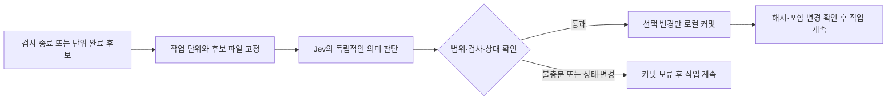

# Jev 작업 단위 자동 커밋 조사

## 조사 범위와 결론

- 날짜 / 목적: 2026-10-23 Asia/Seoul. 장시간 이어지는 에이전트 작업에서 Jev가 작업 단위 완료와 커밋 시점을 판단하는 기능의 공개 구현을 조사했다.
- 환경 / 방법: macOS의 이 저장소에서 웹 검색, GitHub 공개 API의 저장소·트리·커밋 메타데이터, SHA를 고정한 raw 원본을 읽었다. 패키지를 설치하거나 외부 코드를 실행하지 않았다.
- 결론: **`valentynkit/jev-commit`이라는 소스가 실제로 있다. 다만 이미 시작한 커밋의 메시지와 diff를 검사하는 훅이다. 작업 단위 완료를 찾아 자동 커밋하는 기능과는 다르다.** 완료 주장 검사에는 `jev-belay`, 자동 Git 실행 흐름에는 `pi-jev-harness`가 참고가 된다. 후자는 현재 TypeSafe Jev API를 호출하지 않고 Pi 모델이 준 수치를 사용하므로 실제 Jev 완료 판단 구현으로 세면 안 된다. [jev-commit](https://github.com/valentynkit/jev-commit), [Belay](https://github.com/valentynkit/jev-belay), [Pi 분류기](https://github.com/Danu28/pi-jev-harness/blob/e1d319a6bf950e78a4ef4686b44e08482b5eec8e/src/harness/pi-classifier.ts#L1-L56)
- 조사한 범위에서 **실제 TypeSafe Jev + 검증된 작업 단위 완료 + 작업별 변경 선택 + 자동 로컬 커밋**을 모두 갖춘 Codex용 완성 구현은 발견하지 못했다. 이는 GitHub 전체에서 존재하지 않는다는 증명이 아니다.

검색어는 `github Jev commit TypeSafe`, `github jev-belay`, `site:github.com "Jev" "git commit"`, `"auto-commit"`, `"commit-ready"`, `"should_commit"`, `"checkpoint" "commit"`, `"commit" "atomic"` 등을 사용했다. 검색 결과의 소개글은 후보 발굴에만 쓰고 아래 기능 판단은 각 저자의 원본 코드로 확인했다.

## 후보 비교

| 후보 | 실제 역할 | 완료·커밋 시점 판단 | Git 실행 / 기반 |
| --- | --- | --- | --- |
| [valentynkit/jev-commit](https://github.com/valentynkit/jev-commit) | 메시지와 staged diff의 일치, 디버그 잔재, 누락된 작업, 비밀정보 검사 | 이미 사용자가 시작한 commit의 품질 검사 | commit을 시작하지 않음. Git `commit-msg`, 실제 TypeSafe Jev |
| [valentynkit/jev-belay](https://github.com/valentynkit/jev-belay) | 편집 뒤 검사가 없는데 완료를 주장하는 Stop을 탐지 | 완료 주장의 적정성. 작업 묶음 선택은 없음 | commit 없음. Claude Code Stop, 실제 TypeSafe Jev |
| [Danu28/pi-jev-harness](https://github.com/Danu28/pi-jev-harness) | Pi 이벤트에서 자동 add/commit, 수동 Git 도구 | complexity/plan cursor 조건. medium/high는 plan 미완료도 허용 | `git add -A`, `git commit` 있음. **현재 TypeSafe 직접 호출 없음** |
| [okooo5km/jev](https://github.com/okooo5km/jev) | `commit.json`으로 커밋 종류·비밀·호환성 파괴·위험 판단 | 시점·작업 단위 완료 질문 없음 | diff 입력을 분류하는 범용 CLI/스킬, 실제 Jev API 지원 |

각 행의 근거: [jev-commit hook 정의](https://github.com/valentynkit/jev-commit/blob/e2bd64adfb820d5a11ea23ea71a2e7e243c305fb/.pre-commit-hooks.yaml), [Belay 핵심 코드](https://github.com/valentynkit/jev-belay/blob/467968eb7a1c1b174c523299f9ab8159c9999016/belay.mjs#L408-L581), [Pi 자동 커밋](https://github.com/Danu28/pi-jev-harness/blob/e1d319a6bf950e78a4ef4686b44e08482b5eec8e/src/harness/pi-git.ts#L312-L342), [commit 판단 스펙](https://github.com/okooo5km/jev/blob/2d4c4a0b6b481b2cbb744d269be5d9a987344b74/jev/specs/commit.json).

## 1. jev-commit: 이름은 정확히 맞지만 커밋 품질 검사

원본의 [질문 정의](https://github.com/valentynkit/jev-commit/blob/e2bd64adfb820d5a11ea23ea71a2e7e243c305fb/jev_commit/questions.py#L9-L99)는 `jev-1.13.0`과 다섯 Noul 질문을 사용한다. 메시지가 확인 가능한 주장을 하는지, diff가 그 주장을 뒷받침하는지, 임시 디버그 코드가 남았는지, 메시지가 설명하지 않은 작업이 섞였는지, 비밀정보처럼 보이는 값이 있는지를 판단한다.

설치는 `commit-msg` 단계다. 기본 모드는 메시지 불일치 등은 경고하고 로컬 고정밀 비밀정보 패턴만 차단하며, `--strict`는 모델 발견사항도 차단한다. API 오류는 통과시키지만 로컬 비밀정보 검사는 계속 작동한다. 따라서 “모든 오류에서 무조건 commit 허용”으로 해석하면 틀린다. [README의 옵션·한계](https://github.com/valentynkit/jev-commit/blob/e2bd64adfb820d5a11ea23ea71a2e7e243c305fb/README.md#L105-L161), [판정과 belt-only 경로](https://github.com/valentynkit/jev-commit/blob/e2bd64adfb820d5a11ea23ea71a2e7e243c305fb/jev_commit/cli.py#L168-L213), [API 실패 때 로컬 차단](https://github.com/valentynkit/jev-commit/blob/e2bd64adfb820d5a11ea23ea71a2e7e243c305fb/jev_commit/cli.py#L339-L349)

재사용할 가치는 **커밋 전 마지막 메시지·범위 검사**다. `scope_creep`는 메시지에 빠진 작업을 찾을 뿐, 전체 사용자 요구를 충족했는지나 테스트가 마지막 편집 이후 통과했는지는 묻지 않는다. commit 실행과 커밋 경계 탐지는 별도로 구현해야 한다. 이는 위 질문과 CLI 경로를 읽은 설계적 해석이다.

Python 3.10+와 표준 라이브러리를 사용한다. POSIX 경로 `/dev/null`을 Git 설정에 직접 사용하는 부분도 있어 Windows 실제 호환성은 별도 검증이 필요하다. 이번 조사에서는 어느 OS에서도 설치·실행하지 않았다. [요구사항](https://github.com/valentynkit/jev-commit/blob/e2bd64adfb820d5a11ea23ea71a2e7e243c305fb/README.md#L163-L178), [Git 호출 구성](https://github.com/valentynkit/jev-commit/blob/e2bd64adfb820d5a11ea23ea71a2e7e243c305fb/jev_commit/git.py#L1-L45)

## 2. jev-belay: 완료 선언보다 실행 증거를 먼저 확인

현재 공개 원본은 `package.json` 기준 **0.2.0**, Node 20+이며 Claude Code Stop 훅이다. transcript에서 편집과 그 이후의 test/build/lint 증거를 읽고 필요한 경우 `claims_done`, `claims_verified`, `verification_applies`, `outcome`을 Jev에 묻는다. 기본 `claims_done` 임계값은 0.70이다. 작업 단위 응집성, 포함할 파일 선택, `git commit` 실행은 구현하지 않는다. [패키지](https://github.com/valentynkit/jev-belay/blob/467968eb7a1c1b174c523299f9ab8159c9999016/package.json), [질문·판정](https://github.com/valentynkit/jev-belay/blob/467968eb7a1c1b174c523299f9ab8159c9999016/belay.mjs#L408-L581), [Stop 등록](https://github.com/valentynkit/jev-belay/blob/467968eb7a1c1b174c523299f9ab8159c9999016/hooks/hooks.json)

재사용할 부분은 **마지막 편집보다 새로운 검증 증거**, 좁은 질문, 호출·반복 차단 제한, shadow 모드다. 다만 검사를 한 번 발견했다는 사실은 선택한 변경 묶음 전체의 성공을 보장하지 않는다. 자동 커밋에서는 검증 대상과 파일 스냅샷을 연결하는 추가 설계가 필요하다. 이 단락은 원본 동작에서 도출한 제안이다.

이 저장소에는 [Codex Stop 어댑터](../../hooks/jev-belay/codex.mjs)와 [출처 기록](../../hooks/jev-belay/UPSTREAM.md)이 있다. 로컬 vendored 원본은 `c59f030032baedb3a3e5acefd3ead19d9dcde84c`이며 이번에 읽은 공개 HEAD와는 다르다. 현재 로컬 구현과 공개 upstream, 실제 설치본 동작을 같은 상태로 취급하지 않는다.

## 3. pi-jev-harness: 자동 Git 실행은 있지만 실제 Jev 판정은 아님

`agent_settled`와 `session_shutdown`에서 `autoCommitIfDirty()`를 호출하며 명시적인 `jev_git` 도구도 있다. 자동 커밋 경로는 변경이 있고 policy가 있으면 medium/high complexity에서 plan 완료와 무관하게 커밋한다. low는 plan cursor가 끝에 도달해야 한다. **이는 완료를 검증한 작업 단위보다 넓은 조건**이다. [이벤트 연결](https://github.com/Danu28/pi-jev-harness/blob/e1d319a6bf950e78a4ef4686b44e08482b5eec8e/src/index.ts#L148-L193), [실제 조건·실행](https://github.com/Danu28/pi-jev-harness/blob/e1d319a6bf950e78a4ef4686b44e08482b5eec8e/src/harness/pi-git.ts#L312-L342)

현재 분류기는 `no fetch, no Typesafe`라고 명시하며 Pi 모델이 `jev_calibrate`의 점수·확률·confidence 인자를 채우면 이를 policy로 옮긴다. 코드에 Jev라는 이름이 있어도 실제 TypeSafe Jev 모델의 판단이라고 확인할 근거는 없다. [분류기 원본](https://github.com/Danu28/pi-jev-harness/blob/e1d319a6bf950e78a4ef4686b44e08482b5eec8e/src/harness/pi-classifier.ts#L1-L84)

자동 경로는 `git add -A`를 사용하며 필요하면 `git init`, 로컬 Git 사용자 기본값 설정도 수행한다. 메시지도 diff에서 생성하는 대신 입력 state와 complexity/plan에서 조합한다. 기존 사용자 변경과 병렬 작업까지 섞을 수 있으므로 이 저장소에 그대로 설치하는 접근은 권하지 않는다. **이벤트 뒤 실행·해시 readback의 흐름만 참고**할 수 있다. [메시지·Git 설정](https://github.com/Danu28/pi-jev-harness/blob/e1d319a6bf950e78a4ef4686b44e08482b5eec8e/src/harness/pi-git.ts#L62-L95), [자동 경로](https://github.com/Danu28/pi-jev-harness/blob/e1d319a6bf950e78a4ef4686b44e08482b5eec8e/src/harness/pi-git.ts#L312-L342)

## 4. 추가 후보와 공식 프로젝트

`okooo5km/jev`의 [commit.json](https://github.com/okooo5km/jev/blob/2d4c4a0b6b481b2cbb744d269be5d9a987344b74/jev/specs/commit.json)은 Conventional Commit 종류를 Choice로, 비밀·breaking 여부를 Noul로, 위험을 Score로 묻는다. 메시지 문장을 생성하거나 완료 시점을 판별하는 스펙은 아니다. 범용 CLI/Agent Skill이며 공식 TypeSafe 제품은 아니라고 저자가 명시한다. [저자 README](https://github.com/okooo5km/jev/blob/2d4c4a0b6b481b2cbb744d269be5d9a987344b74/README.en.md)

`rashedInt32/jev-gates`는 Claude Code PreToolUse에서 예정된 `git commit`의 주장을 diff와 비교하는 [commit guard](https://github.com/rashedInt32/jev-gates/blob/e803ebbe88246d68c26c395941ef6a057acf5af5/hooks/commit-guard.mjs)다. `devanshbatham/commit-miner`는 이미 존재하는 커밋들을 분류하는 [이력 분석 도구](https://github.com/devanshbatham/commit-miner/blob/977617ebce07c56b965253a68577b1d92b93fdf1/README.md)다. 둘 다 작업 완료 시점 자동 커밋 구현으로 분류하지 않았다.

[TypeSafe 공식 조직](https://github.com/typesafe-ai)의 공개 저장소 목록과 [공식 skills](https://github.com/typesafe-ai/skills/tree/65a39f393687675ce170e6094757de20370365b9), [공식 examples 트리](https://github.com/typesafe-ai/typesafe-public-examples/tree/25e9d373f4853b3e7e300e55a194f50e54838f68)를 확인했다. 공식 SDK·통합 스킬·예제는 확인했지만 그 목록/트리에서 커밋 시점 자동화 전용 프로젝트는 찾지 못했다. 공식 SDK 전체의 모든 코드 경로를 전수 감사한 결론은 아니다.

## 확인한 버전과 라이선스

SHA는 2026-10-23에 GitHub `/commits/main`에서 직접 읽은 commit ID다. mutable한 `main` 링크보다 아래 고정 링크를 구현 검토의 기준으로 삼는다.

- jev-commit: [`e2bd64adfb820d5a11ea23ea71a2e7e243c305fb`](https://github.com/valentynkit/jev-commit/commit/e2bd64adfb820d5a11ea23ea71a2e7e243c305fb), [MIT](https://github.com/valentynkit/jev-commit/blob/e2bd64adfb820d5a11ea23ea71a2e7e243c305fb/LICENSE).
- jev-belay: [`467968eb7a1c1b174c523299f9ab8159c9999016`](https://github.com/valentynkit/jev-belay/commit/467968eb7a1c1b174c523299f9ab8159c9999016), [MIT](https://github.com/valentynkit/jev-belay/blob/467968eb7a1c1b174c523299f9ab8159c9999016/LICENSE).
- pi-jev-harness: [`e1d319a6bf950e78a4ef4686b44e08482b5eec8e`](https://github.com/Danu28/pi-jev-harness/commit/e1d319a6bf950e78a4ef4686b44e08482b5eec8e), [MIT](https://github.com/Danu28/pi-jev-harness/blob/e1d319a6bf950e78a4ef4686b44e08482b5eec8e/LICENSE).
- okooo5km/jev: [`2d4c4a0b6b481b2cbb744d269be5d9a987344b74`](https://github.com/okooo5km/jev/commit/2d4c4a0b6b481b2cbb744d269be5d9a987344b74), [Apache-2.0](https://github.com/okooo5km/jev/blob/2d4c4a0b6b481b2cbb744d269be5d9a987344b74/LICENSE).
- jev-gates: [`e803ebbe88246d68c26c395941ef6a057acf5af5`](https://github.com/rashedInt32/jev-gates/commit/e803ebbe88246d68c26c395941ef6a057acf5af5), [MIT](https://github.com/rashedInt32/jev-gates/blob/e803ebbe88246d68c26c395941ef6a057acf5af5/LICENSE).
- commit-miner: [`977617ebce07c56b965253a68577b1d92b93fdf1`](https://github.com/devanshbatham/commit-miner/commit/977617ebce07c56b965253a68577b1d92b93fdf1). 공개 API의 license가 null이고 루트 LICENSE도 확인되지 않아 코드 재사용 허용 범위는 미확인이다.

## 검증 기록

- 실행한 항목: 공개 웹 검색, GitHub REST `/repos`·`/git/trees/main?recursive=1`·`/commits/main`, 고정 SHA의 raw 소스 읽기, 로컬 문서·차이 확인.
- 원본과 메타데이터: Git 관리 밖의 `.runtime/experiments/jev-commit-research-20261023/public-sources/`. 공개 저장소 파일만 저장했고 인증정보나 대화를 저장하지 않았다.
- 오프라인: 문서의 경로·링크·차이 확인만 수행했다. 외부 후보의 테스트 스위트는 실행하지 않았다.
- 샌드박스 설치 / 실제 API / 실제 자동 실행: 모두 미실행. 패키지 설치, Codex 설정 변경, git commit, push, 유료 API 호출은 수행하지 않았다.
- 한계: 원본에 자동 commit 코드가 있는 것과 현재 호스트 이벤트에서 실제 자동 실행되는 것은 별도다. macOS·Windows 동작, 한국어 판단 품질, 실제 작업 단위 분할 품질은 미검증이다.

## 로컬 구조에 근거한 기획 평가

이 절은 공개 프로젝트의 기능 설명과 구분한 Codex의 설계 제안이다. 구현하거나 성능을 측정한 결과가 아니다.

**평가: 개인용 Codex 확장으로 실용성이 높고, 범위를 좁힌 MVP를 권장한다.** 긴 작업을 멈추지 않고 검토·복구 가능한 변경 이력을 남기는 문제가 분명하다. 제품의 차별점은 시간 간격이 아니라 작업의 의미에 맞춰 커밋 경계를 찾는 데 있다. 단위 판단과 변경 출처 확인이 어려우므로 범용 자동 커밋의 완성도는 별도 검증이 필요하다.

예를 들어 로그인 오류 처리, 관련 테스트, 사용법 수정이 한 요구사항을 완성하면 함께 커밋하고, 다음 프로필 기능은 다음 커밋으로 넘긴다. 파일 수나 경과 시간만으로 나누지 않는다. 테스트 하나가 성공하거나 에이전트가 “완료”라고 말한 것만으로 단위가 완성됐다고 간주하지 않는다.

### 현재 재사용할 수 있는 로컬 부품

- [`hooks/jev-belay/codex.mjs`](../../hooks/jev-belay/codex.mjs)는 `Stop`에서만 동작한다. `stop_hook_active` 재진입 방지와 외부 전송 동의 설정이 있다. 연속 작업 도중의 단위 판별과 Git 실행은 추가 기능이다.
- [`hooks/jev-belay/upstream/belay.mjs`](../../hooks/jev-belay/upstream/belay.mjs)의 `QUESTIONS`는 완료 주장, 검사 성공 주장, 검사의 적합성, 최종 보고 상태를 묻는다. 이는 기능의 실제 완성도나 독립적인 커밋 가능성을 증명하지 않는다.
- [`hooks/jev-belay/codex-evidence.mjs`](../../hooks/jev-belay/codex-evidence.mjs)와 [`hooks/jev-belay/UPSTREAM.md`](../../hooks/jev-belay/UPSTREAM.md)는 수정 이후 검사의 신선도, 실행 중인 명령, 순서를 알 수 없는 배치 등 기존 근거 수집과 한계를 참고할 수 있다. 이번에는 전역 설치본의 활성화나 실제 이벤트 전달을 검사하지 않았다.
- [`hooks/north-star/automatic.py`](../../hooks/north-star/automatic.py)는 작업 중 `PostToolUse`를 처리하는 로컬 구조의 참고다. 목표 연속성 판단을 커밋 실행 권한으로 사용하면 안 된다.

Codex 공식 문서는 `PostToolUse`가 도구 결과 뒤에 실행되고, 기본 동기 훅은 끝날 때까지 다음 동작을 기다린다고 설명한다. 따라서 후보 검사 시점으로 사용할 수 있다. 다만 다른 터미널·에이전트의 쓰기까지 멈추는 보장은 없으므로 저장소 전체의 동시 작업 제어가 별도로 필요하다. 설치된 앱의 실제 도구 이름과 코드 모드·장기 실행 명령 완료 이벤트도 샌드박스에서 확인해야 한다. [공식 Hooks 문서](https://learn.chatgpt.com/docs/hooks)

### 권장 책임 분리

| 담당 | 판단하거나 수행할 일 |
| --- | --- |
| 주 에이전트 | 사용자 요구에서 작업 단위·완료 조건을 만들고, 후보 파일과 커밋 메시지를 제안한다. |
| Jev | 해당 단위의 완료 근거가 충분한지, 후보 변경이 하나의 목적에 속하는지, 관련 미완료 작업이 있는지 각각 판단한다. |
| 실행 코드 | 허용 범위·변경 출처·검사 결과·현재 파일 상태를 확인하고 Git을 실행·읽기 검증한다. |

Jev는 자유 문장 생성 대신 `Choice`, `Score`, `Noul` 형태의 값을 반환한다. 따라서 커밋 메시지는 주 에이전트나 템플릿이 만들고 Jev가 적합성을 검사하는 편이 맞다. 여러 조건을 하나의 “커밋해도 돼?” 질문에 넣지 않고 분리한 다음 코드에서 조합한다. 모델 확률은 실행 허가나 실제 성공의 증거가 아니다. [TypeSafe 공식 설명](https://docs.typesafe.ai/introduction)

### 첫 MVP의 범위

1. **관찰 모드부터 시작한다.** 커밋 후보 단위, 포함 파일, 제안 메시지, 근거와 보류 사유를 로컬에 기록한다. 실제 Git 쓰기는 하지 않는다. 이후 저장소별로 허용한 자동 모드에서만 매번 질문하지 않고 로컬 커밋한다.
2. **판단 시점은 후보가 생겼을 때로 제한한다.** 검사 명령이 실제 종료됐거나 명시한 하위 작업의 결과가 나왔을 때 평가한다. 매 도구 호출이나 일정 시간마다 외부 API를 부르지 않는다. 같은 변경의 중복 판단도 억제한다.
3. **단일 작업자와 파일 단위 선택을 우선한다.** 시작 시 기존 변경과 staging 상태를 기록한다. 기존 staging이 있거나, 같은 파일에 사용자·다른 작업의 변경이 섞였거나, 하나의 파일에 여러 작업 단위가 얽히면 자동 커밋을 보류한다. 부분 hunk 자동 분할은 후속 범위다.
4. **커밋할 바로 그 스냅샷을 검증한다.** 포함·제외 파일을 반영한 후보 트리에서 관련 검사 결과를 확인한다. 다른 미커밋 변경이 있어야 통과하는 테스트는 독립 커밋의 근거가 아니다. 검사 뒤 파일·HEAD·index 상태가 바뀌면 후보를 폐기한다. 문서 변경은 링크·경로·차이 검토 등 맞는 검사를 쓴다.
5. **실행 경로는 보수적으로 만든다.** 충돌·merge/rebase 진행 중·다른 작성자·출처 불명 변경·비밀정보 의심·근거 누락·API 장애에서는 자동 커밋을 건너뛴다. 생성물과 ignored 파일은 기본 제외한다. `git add -A`, 자동 push, amend, 강제 reset, `--no-verify`는 MVP에 포함하지 않는다. 기존 Git 훅과 서명 설정은 따른다.
6. **성공은 읽어서 확인한다.** 커밋 전후 HEAD, 예상 부모, 포함 변경과 결과 해시를 비교한다. 응답이 불명확하면 이미 생긴 커밋을 먼저 확인해 중복 생성을 피한다. 실행 근거가 확인된 뒤에만 “중간 커밋 완료”를 알리고 다음 작업을 이어간다.

Git의 일반 `commit`은 index의 내용을 기록한다. 따라서 파일 목록을 고르는 것과 기존 staging을 보호하는 것은 별개의 문제다. `write-tree`는 index의 트리를 만들 수 있지만, 그것만으로 테스트나 작업 단위의 타당성이 보장되지는 않는다. [git-commit 공식 문서](https://git-scm.com/docs/git-commit), [git-write-tree 공식 문서](https://git-scm.com/docs/git-write-tree)

### 실패 비용과 평가 방법

잘못된 자동 커밋은 검토·되돌리기를 어렵게 하고, 다른 사람의 변경이나 비밀정보가 섞이면 피해가 커진다. 반대로 커밋 후보 하나를 놓치는 비용은 대체로 이후 수동 커밋으로 회복할 수 있다. 초기에는 **후보를 많이 잡는 것보다 잘못된 자동 실행을 줄이는 것**을 우선한다.

평가 자료는 합성 작업 흐름과 별도 허용된 표본으로 만든다. 완료된 기능, 다중 기능 혼합, 테스트 후 재수정, 실행 중 테스트, 문서만 변경, 부분 staging, 같은 파일 동시 수정, 이전 작업의 잔여 변경, 훅 실패, 네트워크 시간 초과, 중복 이벤트를 포함한다. macOS와 Windows의 경로·개행·Git 실행도 각각 검사한다.

사람이 붙인 “여기서 커밋할 수 있음/계속 작업/판단 불가” 라벨과 비교해 잘못된 후보 비율, 놓친 경계, 파일 혼입, 실제 포함 트리와 검사 트리의 일치, 지연·호출 횟수를 측정한다. 한국어 작업 설명도 별도 평가한다. 확률 임계값은 이 자료로 정하며, 기존 Belay의 `0.75`를 자동 커밋에 그대로 복사하지 않는다. 관찰 자료에서 오류가 없었다고 전체 상황에서의 무오류를 보장하지 않는다.

### 외부 전송 경계

현재 로컬 Belay 문서는 수정 횟수와 검사 요약, 제한된 작업·최종 응답 발췌만 전송하며 **파일 내용·diff·전체 대화는 제외**한다고 기록한다. 새 기능에서 diff나 후보 코드 발췌를 TypeSafe로 보내면 기존 범위가 넓어진다. 실제 구현 단계에서 전송 대상·필드·크기·보관·호출 범위를 먼저 구체화하고 그 범위의 허용을 받아야 한다. 비밀정보 검사·마스킹은 API 호출 전에 수행하며 의심스러운 후보는 전송하지 않는다. 자동 탐지로 모든 비밀정보 제거가 보장되지는 않는다. 이번 조사는 공개 소스만 읽었고 TypeSafe API를 호출하지 않았다. [로컬 전송 계약](../../hooks/jev-belay/UPSTREAM.md)

## 이번 조사 기록

- 날짜 / 목적: 2026-10-23, 공개 Jev 커밋 판단 구현 조사 및 작업 단위별 자동 커밋 기획 평가.
- 대상 / 환경: 공개 GitHub 원본과 이 저장소의 Belay·North Star 코드, macOS 읽기 검토.
- 실행 / 입력: 웹 검색, 공개 소스 다운로드·검색, 로컬 소스·문서 읽기, 최종 Markdown의 경로·링크·차이 검사.
- 관찰 결과: 커밋 품질 검사와 완료 주장 검사는 재사용 후보가 있다. 작업 중 단위 경계 탐지·안전한 파일 선택·검증된 스냅샷 커밋은 별도 설계가 필요하다.
- 검증 상태: 공개·로컬 소스 정적 검토와 문서 검사만 수행. 샌드박스 설치, 실제 TypeSafe API, 자동 커밋, Codex의 실제 자동 이벤트 실행은 수행하지 않음. Windows 실행도 미검증.
- 결과 파일: 이 README. 다음 구현 단계로는 실제 Git 쓰기 없는 관찰 모드와 합성 사례 평가를 권장한다.
